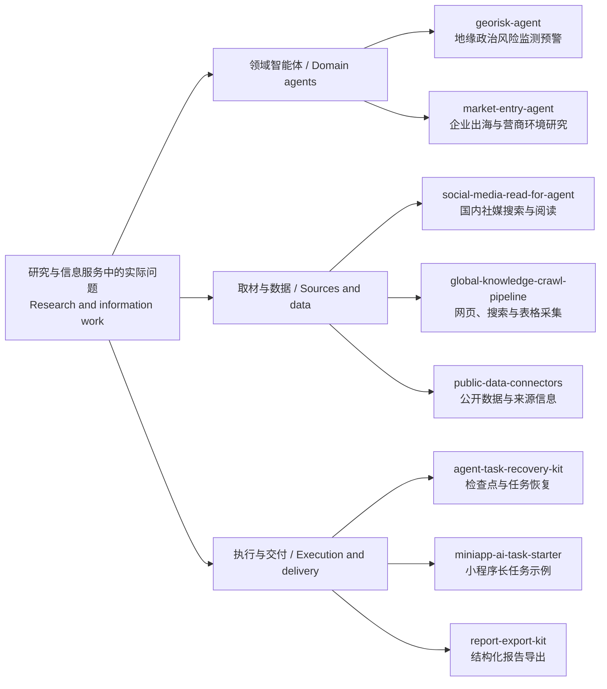

# Workstone · Global Knowledge Network

**把信息追踪、国区研究和企业出海问题，做成能运行的 Agent 与工具。**

**Research agents and practical tools for global expansion, geopolitical risk, and information workflows.**

我是 GKN 团队成员，从研究与信息服务出发，与 AI Agent 协作推进工具和产品落地。这里分享我们从实际工作中整理出的开源项目，覆盖社媒调研、公开信息采集、地缘政治风险、企业出海研究，以及任务恢复和报告交付。

近期新增了两个独立的领域智能体：一个关注地缘政治变化如何影响人员、资产和业务，另一个结合企业实际情况研究市场进入与营商环境。它们共用相同版本的基座与证据格式，各自保存私有任务和报告。页面下方也保留了信息采集、社媒阅读、页面编辑和其他工具的入口。

I am a member of Global Knowledge Network (GKN), working with AI agents to turn research workflows into practical tools. Recent releases add geopolitical-risk and market-entry agents, alongside social research, information collection, task recovery and report delivery. Feedback and contributions are welcome.

[主要项目 / Start here](#start-here--从这里开始) · [项目关系 / Project map](#project-map--项目关系) · [更多工具 / More tools](#more-tools--更多工具) · [社区贡献 / Contributions](#open-source-contributions--开源贡献) · [关于我 / About](#about-me--global-knowledge-network)

## Start here / 从这里开始

| 你想完成的事 / Your goal | 项目 / Project | 看演示与开始使用 / Try it |
| --- | --- | --- |
| **持续理解地缘政治风险**：围绕人员、资产、航线和业务读取来源，保存风险简报与观察清单。 / Research geopolitical developments against your business exposure. | **[地缘政治风险监测预警智能体](https://github.com/workstonedai-collab/georisk-agent)** · `georisk-agent` | [v0.4.0](https://github.com/workstonedai-collab/georisk-agent/releases/tag/v0.4.0) · [公开示例 / Examples](https://github.com/workstonedai-collab/georisk-agent/tree/main/examples) · [流程与技术路线 / Workflow](https://github.com/workstonedai-collab/georisk-agent#workflow) |
| **研究市场进入与经营变化**：结合产品、阶段和约束，梳理进入路径、机会和待验证条件。 / Study entry options and changes in a target market. | **[企业出海咨询/国区营商环境监测智能体](https://github.com/workstonedai-collab/market-entry-agent)** · `market-entry-agent` | [v0.4.0](https://github.com/workstonedai-collab/market-entry-agent/releases/tag/v0.4.0) · [公开示例 / Examples](https://github.com/workstonedai-collab/market-entry-agent/tree/main/examples) · [流程与技术路线 / Workflow](https://github.com/workstonedai-collab/market-entry-agent#workflow) |
| **让 Agent 搜索、阅读国内社媒**：跨平台读原文，提取小红书图中文字，查看有限评论，保留可回查的来源。 / Search and read Chinese social platforms with your local agent. | **[智能体国内社媒使用工具](https://github.com/workstonedai-collab/social-media-read-for-agent)** · `social-media-read-for-agent` | [把仓库交给 Agent](https://github.com/workstonedai-collab/social-media-read-for-agent#把仓库交给-agent) · [安装说明 / Setup](https://github.com/workstonedai-collab/social-media-read-for-agent/blob/main/docs/installation.md) · [虚构数据演示 / Fictional demo](https://github.com/workstonedai-collab/social-media-read-for-agent/blob/main/docs/assets/offline-demo.jpg) |
| **把分散的信息整理成自己的表格**：追踪网页、RSS 与关键词，用自选 API 做摘要、标签和字段富化。 / Track sources and searches into custom information tables with optional AI enrichment. | **[GKN 全球信息采集程序](https://github.com/workstonedai-collab/global-knowledge-crawl-pipeline)** · Global Knowledge Crawl Pipeline | [无需密钥的离线案例 / Offline case](https://github.com/workstonedai-collab/global-knowledge-crawl-pipeline/blob/main/docs/walkthrough.zh-CN.md) · [English guide](https://github.com/workstonedai-collab/global-knowledge-crawl-pipeline/blob/main/docs/walkthrough.en.md) |
| **看着页面改样式，再保存回源码**：点选元素、预览 CSS、保存与撤销，适合调整 Agent 生成的静态页面。 / Select an element, preview CSS changes, save to source, and undo. | **[Click-to-CSS · 点选式网页样式编辑器](https://github.com/workstonedai-collab/click-to-css)** | [操作演示 / Walkthrough](https://github.com/workstonedai-collab/click-to-css/blob/main/docs/walkthrough.zh-CN.md) · [English guide](https://github.com/workstonedai-collab/click-to-css/blob/main/docs/walkthrough.en.md) |

两个领域智能体提供自托管网页、公开数据看板和虚构演示。国区评分配方与通用研究步骤公开；部分进一步研究方法、专用提示词及相关知识内容暂未开源，如需使用或交流，欢迎通过作者主页或项目Issue联系。 / Both agents are self-hosted alpha projects with public data, published reference calculations and general research steps. Some specialized methods, prompts and knowledge remain non-public; contact the author for further discussion.

### 不熟悉配置？把项目链接交给你的 Agent

社媒工具已接入**小红书、微博、知乎和微信公众号**，支持 Codex、Hermes 等本地 Agent。Agent 可以自动准备独立运行环境、配置工具并引导登录，无需你预先安装 Python、Node 或复制 Cookie。你需要确认官方浏览器扩展权限，并在平台页面正常登录；当前为只读预览版，自动浏览器设置主要覆盖 macOS + Chrome。

The social reader connects Xiaohongshu, Weibo, Zhihu, and WeChat public-account articles to local agents such as Codex and Hermes. Let the agent prepare its runtime and guide setup; you approve the browser extension and sign in on the platforms. It is a read-only preview, with automatic browser setup primarily verified on macOS + Chrome.

复制下面这段给你的本地 Agent / Copy this to your local agent:

> 请安装并配置 https://github.com/workstonedai-collab/social-media-read-for-agent 。先阅读仓库 AGENTS.md 和安装说明，自动准备环境，使用专用浏览器资料，引导我确认扩展授权并正常登录。不要向我索取 Cookie、密码或验证码。完成后，在当前对话里实际搜索并阅读一次，说明可用平台与读取范围。

建议使用个人隐私内容较少的专用账号。平台再次要求登录或安全验证时，需要本人正常完成。各项目的支持范围、许可证和详细步骤以仓库说明为准。

看看另外两个工具的实际演示 / See the tools in action

**信息采集：来源 → 自定义表格 → 证据与复用。 / Information collection: sources → table → evidence and reuse.**

以下是实际运行的虚构离线案例，无需账号、联网或模型密钥。 / A real run using fictional offline fixtures, with no account, network, or model key.

**页面样式：点选 → 预览 → 保存 → 撤销。 / CSS editing: select → preview → save → undo.**

以下是自带静态页面中的实际编辑演示。 / An actual edit in the included static example.

## Project map / 项目关系

这些项目围绕取材、研究、执行和交付展开。下图按用途组织入口；实际使用时，可以按需要选择单个工具或自行连接工作流程。

These projects address different parts of research work. The map groups them by purpose; you can use one tool or connect selected tools in your own workflow.

[下载项目关系图 / Download SVG](assets/project-map.svg)

## More tools / 更多工具

| 项目 / Project | 用途 / Purpose |
| --- | --- |
| [AI Evidence Check](https://github.com/workstonedai-collab/ai-evidence-check) | 将 AI 提取的字段、引用、数字与提供的原文对照，生成复核报告。 / Compare extracted fields, quotations, and numbers with supplied source text. |
| [Miniapp AI Task Starter](https://github.com/workstonedai-collab/miniapp-ai-task-starter) | 小程序长任务示例：创建任务、分步保存、显式恢复与重开结果；附虚构离线演示。 / A local miniapp task example with checkpointing, explicit retry and saved-result reopen. |
| [Agent Task Recovery Kit](https://github.com/workstonedai-collab/agent-task-recovery-kit) | 保存本地检查点，在中断后恢复顺序任务，复用已完成结果。 / Checkpoint and resume sequential workflows locally. |
| [Report Export Kit](https://github.com/workstonedai-collab/report-export-kit) | 将结构化内容、表格和图表导出为 PDF、Word 和 Markdown。 / Export structured reports, tables, and charts. |
| [Public Data Connectors](https://github.com/workstonedai-collab/public-data-connectors) | 接入 World Bank、Eurostat 和 GLEIF，保留单位、时间和来源。 / Access public datasets with provenance. |
| [Bilingual News Dedupe](https://github.com/workstonedai-collab/bilingual-news-dedupe) | 中英文资讯流程中的去重工具。 / Deduplication for Chinese and English news workflows. |
| [Source Rights Gate](https://github.com/workstonedai-collab/source-rights-gate) | 可配置的信息来源权限与采集规则。 / Configurable source permissions and collection rules. |
| [Human Review Research Agent](https://github.com/workstonedai-collab/human-review-research-agent) | 带人工复核的研究智能体示例。 / A research-agent example with human review. |
| [Miniapp Project Check](https://github.com/workstonedai-collab/miniapp-project-check) | 小程序项目配置的本地检查工具。 / Local checks for mini-program project setup. |

## Open-source contributions / 开源贡献

We also contribute fixes and documentation to tools we use. Status below was checked on **2026-10-16**; the linked pull requests contain the latest updates.

我们也向使用的开源工具提交修复和文档改进。以下状态核对于 **2026-10-16**，最新进展请查看对应 PR。

| Project / 项目 | Contribution / 贡献 | Status / 状态 |
| --- | --- | --- |
| [Kandev](https://github.com/kdlbs/kandev/pull/4082) | Documented E2E setup for a fresh checkout. / 补充从新检出项目开始的端到端测试准备说明。 | **Merged; included in [v0.97.0](https://github.com/kdlbs/kandev/releases/tag/v0.97.0). / 已合并，并进入正式版本。** |
| [Trafilatura](https://github.com/adbar/trafilatura/pull/944) | Linked existing URL-discovery tools from extraction guidance. / 在内容提取说明中补充已有链接发现工具的入口。 | **Merged. / 已合并。** |
| [MarkItDown](https://github.com/microsoft/markitdown/pull/2529#issuecomment-5997199878) | Fixed code-fence handling after list markers, preserving code whitespace. / 修复列表标记后代码围栏的处理，保留代码空白。 | **Patch adopted into the original author's PR branch with authorship preserved; upstream PR awaits merge. / 补丁已被原作者纳入其 PR 分支并保留署名，上游 PR 待合并。** |

关于我与 GKN / About me and GKN

## About Me & Global Knowledge Network

I am a team member at **Global Knowledge Network (GKN)**. Drawing on our professional expertise and research backgrounds, we provide advisory and connection services to businesses and individuals pursuing international expansion. Many of our team members come from universities. We bring research into practical business contexts, helping clients understand the international landscape, assess questions around global expansion, and connect with relevant resources and potential partners.

In the AI era, we are integrating AI agents into our research and business workflows to explore new ways of delivering services and building tools. Our current work focuses on:

- **Monitoring and assessing emerging developments:** Using AI to track information, identify emerging issues, and examine their context, evolution, and potential implications.
- **Analyzing global expansion and international affairs:** Conducting in-depth analysis grounded in source evidence on international expansion needs, geopolitical developments, international sanctions, and export controls.
- **Building products and tools:** Developing SaaS platforms, mini apps, and automation tools that make research and analysis more accessible in everyday business workflows.

This account documents our open-source work and contributions to the wider community. We share reusable tools developed through our practice, covering information collection, evidence checking, public data access, task recovery, and report generation. We hope they will also be useful to other researchers, developers, and teams.

## 关于我与 Global Knowledge Network

我是 **Global Knowledge Network（GKN）** 的团队成员。我们依托团队的专业知识与科研背景，面向有出海需求的企业和个人，提供咨询与连接服务。团队成员多来自高校，致力于将研究能力与实际业务需求相结合，帮助客户理解国际环境、分析出海问题，并连接相关资源与合作机会。

在 AI 时代，我们正在将 AI Agent 融入研究与业务流程，探索新的服务方式和工具。当前的尝试主要集中在：

- **热点追踪与研判**：使用 AI 持续追踪信息，识别热点，并分析其背景、变化及潜在影响。
- **出海与国际议题分析**：围绕出海需求、地缘政治热点、跨国制裁和出口管制等议题，开展有来源依据的深度分析。
- **产品与工具开发**：开发 SaaS 平台、小程序和自动化工具，让研究与分析能力更方便地应用于实际业务。

这个账号记录我们在上述方向上的开源实践与社区贡献。我们将实践中具有通用价值的工具整理出来，涉及信息采集、证据校验、公共数据接入、任务恢复和报告生成，希望它们也能帮助其他研究者、开发者和团队开展工作。

## Feedback & collaboration / 反馈与协作

试用后，欢迎在对应仓库提交 Issue，告诉我们你想完成什么、用了哪个版本，以及卡在哪一步。附上复现步骤和使用公开或合成数据的最小示例，更方便一起解决。也欢迎分享完成任务的实际案例，或提交改进。

If you try a tool, please open an issue in its repository with your goal, version, what happened, and reproduction steps. A minimal example using public or synthetic data helps us investigate. Practical usage stories and contributions are welcome.
